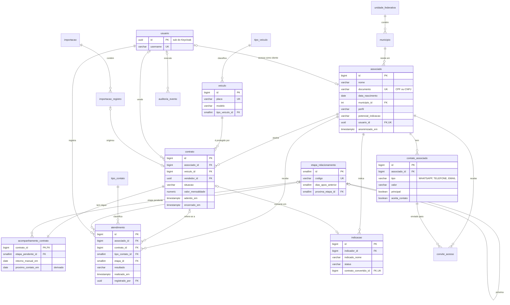

# Modelo de dados

> [Dicionário de dados](dicionario-de-dados.md) · [Histórias de usuário](../historias/README.md) · Migration: [`V2__modelo_dominio.sql`](../../backend/src/main/resources/db/migration/V2__modelo_dominio.sql)

O banco é PostgreSQL 16, versionado pelo Flyway. O modelo de domínio (V2) roda depois da V1 da base do projeto e tem 17 tabelas, 3 visões e 1 função, divididos em 7 módulos. Ele segue a terceira forma normal, com uma única desnormalização controlada: a data do próximo contato, gravada para as filas serem rápidas.

## Diagrama

O centro do modelo é o **contrato**: ele liga um associado a um veículo, e é sobre ele que a régua de pós-venda roda. Pessoa, veículo e contrato, que na planilha dividiam a mesma linha, viraram três tabelas.



O diagrama mostra só as colunas principais. A lista completa, com tipos, padrões, restrições e índices, está no [dicionário de dados](dicionario-de-dados.md).

## Módulos

Os módulos correspondem aos pacotes do backend (`br.com.superauto.crm.<módulo>`), então cada tabela tem um dono claro no código.

| Módulo | Tabelas | Responsabilidade |
| --- | --- | --- |
| Referência | `unidade_federativa`, `municipio`, `tipo_veiculo`, `tipo_contato`, `etapa_relacionamento` | Domínios editáveis e a régua de pós-venda |
| Acesso | `usuario`, `convite_acesso` | Projeção dos usuários do Keycloak e primeiro acesso do cliente |
| Cadastro | `associado`, `contato_associado`, `veiculo`, `contrato` | Quem é o cliente, como falar com ele e o que ele contratou |
| Relacionamento | `acompanhamento_contrato`, `atendimento` | Onde cada contrato está na régua e o histórico de contatos |
| Comercial | `indicacao` | Indicações e sua conversão em contratos |
| Importação | `importacao`, `importacao_registro` | Carga da planilha, com cada linha guardada como veio |
| Auditoria | `auditoria_evento` | Alterações e acessos a dados pessoais (LGPD) |

## Decisões de modelagem

A planilha guardava tudo numa linha por placa, com fórmulas misturadas aos dados. O modelo separa cada fato num único lugar e deixa fora das tabelas o que é calculado.

| # | Decisão | Problema na planilha | Ganho |
| --- | --- | --- | --- |
| 1 | Associado, veículo e contrato em tabelas separadas | Quem tem duas placas aparece em duas linhas, com CPF, telefone e e-mail repetidos | Atualizar o telefone uma vez vale para todos os contratos (2FN/3FN) |
| 2 | Telefones e e-mails em `contato_associado` | Um só WhatsApp e um só e-mail por linha | Vários contatos por pessoa, um principal por tipo, opt-out por contato (1FN) |
| 3 | Cidade via `municipio` com código IBGE, e UF vinda do município | Cidade e UF digitadas, sujeitas a grafias diferentes | Relatório por cidade confiável; UF nunca contradiz a cidade (3FN) |
| 4 | Atendimento guarda só chaves, nunca nome ou placa | ATENDIMENTOS copia nome e placa do cliente | Corrigir um nome não deixa o histórico desatualizado |
| 5 | Último contato e etapa concluída calculados do histórico (`vw_ultimo_contato_regua`) | Os mesmos fatos ficavam no histórico e na carteira | Não há duas versões da verdade |
| 6 | Estado da régua em `acompanhamento_contrato` (1:1 com contrato) | — | Dados do SGA e trabalho da equipe mudam separados, sem conflito de lock otimista |
| 7 | Régua como dados em `etapa_relacionamento`, cada etapa apontando para a seguinte | Prazos fixos na aba CONFIGURACOES e sequência fixa na macro | Mudar prazo é um `UPDATE`, sem novo deploy |
| 8 | Tipo de pessoa, próxima ação e status da fila não são armazenados | Colunas FILA, AÇÃO, ORDEM e flags | São derivados do documento, do resultado e da data de hoje |
| 9 | Identidade fica no Keycloak; `usuario` é só uma projeção local | Campo USUÁRIO com o login do Windows | Papéis têm uma única fonte; o banco só precisa do id para as FKs |
| 10 | Atendimento é imutável; correção é um novo registro que aponta para o corrigido | Histórico editável à mão | Trilha confiável para auditoria |

**A desnormalização controlada.** `acompanhamento_contrato.proximo_contato_em` poderia ser calculado a cada consulta. Ele fica gravado porque as filas Hoje e Atrasados são a tela mais usada e precisam de índice. O valor é recalculado pelo mesmo serviço que registra o atendimento, na mesma transação, e reprocessado quando um prazo da régua muda.

**Integridade garantida pelo banco, não só pelo código:**

- Um veículo só tem um contrato vigente por vez (índice único parcial `uk_contrato_veiculo_vigente`).
- O contrato de um atendimento tem de pertencer ao mesmo associado (chave estrangeira composta `fk_atendimento_contrato`).
- Indicação só fica `CONVERTIDA` se apontar para o contrato gerado, e cada contrato vem de no máximo uma indicação.
- Contrato cancelado exige data de encerramento; contrato importado exige a linha de origem.
- CPF, CNPJ (inclusive o alfanumérico), placa e telefone são validados por formato.
- O documento só pode ficar vazio em cadastro anonimizado (`ck_associado_documento_obrigatorio`).

**Domínios: tabela ou lista fixa.** Valores que a equipe pode querer ampliar viram tabela (`tipo_veiculo`, `tipo_contato`, `municipio`). Valores que mudam o comportamento do sistema ficam como texto com `CHECK` e viram `enum` em Java: situação do contrato, resultado do atendimento, status e canal da indicação, perfil e potencial. Assim, um valor novo nesses campos obriga a mexer no código que o trata. Não há tabela genérica de domínios (o antipadrão *one true lookup table*).

## Cálculo do próximo contato

O prazo pertence à etapa que está por vir: `dias_apos_anterior` conta a partir do contato anterior concluído ou, na primeira etapa, da adesão. O resultado é o mesmo das fórmulas da planilha, onde o prazo ficava na etapa já concluída.

1. Se houver `retorno_manual_em`, ele vale.
2. Senão, se o contrato já teve contato de régua concluído: data desse contato + `dias_apos_anterior` da etapa pendente.
3. Senão: data de adesão (`aderido_em`) + prazo da etapa inicial (D+7, 7 dias).

Exemplo: adesão em 13/03/2026 gera o D+7 para 20/03. Se o D+7 for concluído em 25/03, a etapa pendente passa a D+30, prevista para 17/04 (25/03 + 23 dias).

| Resultado registrado (pós-venda) | Etapa pendente | Retorno manual | Histórico |
| --- | --- | --- | --- |
| Concluído | Avança para a próxima (Trimestral repete) | Apagado, salvo nova data informada | Grava com a etapa concluída |
| Sem resposta | Mantida | Data informada, ou hoje + 2 dias | Grava |
| Reagendado | Mantida | Data informada (obrigatória) | Grava |
| Pendente | Mantida | Mantido | Grava |
| Mensagem de aniversário | Não muda | Não muda | Grava como tipo Aniversário, sem contrato |
| Qualquer, em contrato cancelado | — | — | Recusado |

Essa regra vive num único serviço de domínio no backend, coberto por testes. O banco não tem triggers de negócio: só garante que o resultado seja consistente. As regras completas estão em [ATD-01](../historias/04-atendimentos.md).

## Mapeamento da planilha

Toda coluna digitada da planilha tem um destino. As colunas de fórmula deixam de existir como dado: viram cálculo no serviço ou numa visão.

| Aba e coluna | Destino no modelo | Observação |
| --- | --- | --- |
| CARTEIRA · CLIENTE, CPF/CNPJ | `associado.nome`, `associado.documento` | Documento só com dígitos; chave para juntar as placas da mesma pessoa |
| CARTEIRA · WHATSAPP, E-MAIL | `contato_associado` (principal) | Telefone normalizado para 55 + DDD + número |
| CARTEIRA · CIDADE, UF | `associado.municipio_id` | Casado com a tabela do IBGE pelo nome e UF, sem acento |
| CARTEIRA · NASCIMENTO, PERFIL, POTENCIAL INDICAÇÃO | `associado` | — |
| CARTEIRA · PLACA, VEÍCULO / MODELO, TIPO DE VEÍCULO | `veiculo` | Placa em maiúsculas, sem hífen |
| CARTEIRA · MENSALIDADE, CONTRATO, CADASTRO SGA | `contrato.valor_mensalidade`, `situacao`, `aderido_em` | "A conferir" vira `A_CONFERIR` |
| BASE HISTORICA · DATA VENDA | `contrato.vendido_em` | — |
| CARTEIRA · ORIGEM / REGISTRO | `contrato.importacao_registro_id` | Liga o contrato à linha original importada |
| CARTEIRA · ETAPA, RETORNO MANUAL | `acompanhamento_contrato.etapa_pendente_id`, `retorno_manual_em` | "Não iniciado" vira D+7 pendente; "Concluído" vira régua encerrada |
| CARTEIRA · ÚLTIMO CONTATO, ETAPA CONCLUÍDA | Um `atendimento` concluído, quando preenchidos | Depois disso são lidos da visão, nunca gravados |
| CARTEIRA · PRÓXIMO CONTATO, RETORNO CALCULADO | `acompanhamento_contrato.proximo_contato_em` | Recalculado pela regra acima |
| CARTEIRA · AÇÃO, FILA, ORDEM …, PRÓXIMO ANIVERSÁRIO, ANIVERSÁRIO HOJE FLAG | Não armazenadas | Link do WhatsApp montado no front; fila e aniversário pelas visões |
| ATENDIMENTOS · DATA / HORA, TIPO, ETAPA, RESULTADO, DESCRIÇÃO, DATA EXCEÇÃO | `atendimento.realizado_em`, `tipo_contato_id`, `etapa_id`, `resultado`, `descricao`, `retorno_agendado_para` | — |
| ATENDIMENTOS · PLACA, CLIENTE | `atendimento.contrato_id`, `associado_id` | Resolvidos pela placa (ou pelo nome, se a placa estiver vazia); o texto não é copiado |
| ATENDIMENTOS · USUÁRIO, PRÓXIMA AÇÃO | `registrado_por`; ação derivada do resultado | Logins do Windows ignorados: o histórico importado fica no usuário técnico `sistema.importacao` |
| INDICACOES · todas | `indicacao` | PLACA FECHADA vira `contrato_convertido_id` |
| CONFIGURACOES · prazos | `etapa_relacionamento.dias_apos_anterior` | "Limite central" (650 linhas) deixa de existir |
| BASE HISTORICA · linha inteira | `importacao_registro.dados_originais` | As 286 linhas originais ficam guardadas como vieram; as 2 versões antigas de placa repetida ficam como `DUPLICADO` |
| PAINEL, CENTRAL DO DIA, ATRASADOS, ANIVERSARIANTES, INTELIGENCIA | Consultas | Nenhum dado próprio |

## Decisões tomadas

| Ponto | Decisão |
| --- | --- |
| Dono do cliente | O vendedor fica no contrato (`contrato.vendedor_id`) |
| Histórico de mensalidade | Só o valor atual; cada reajuste fica registrado em `auditoria_evento` |
| Placas repetidas na base histórica | As versões antigas ficam só em `importacao_registro`, como `DUPLICADO` |
| Resultado "Pendente" | Mantido entre os resultados possíveis |
| Usuários antigos (logins do Windows) | Ignorados. Atendimentos e importações vindos da planilha ficam no usuário técnico `sistema.importacao` ("Importação da planilha"), inativo e fora do Keycloak |
| Mudança de prazo da régua | Vale para todos os contratos; o próximo contato é recalculado, exceto onde há retorno manual |
| Busca sem acento | Nos dois sentidos: "jose" encontra "José" e "José" encontra "Jose". A função `texto_busca()` (extensão `unaccent` + minúsculas) normaliza o nome gravado e o termo digitado, com índice próprio |
| Anonimização (LGPD) | `associado.documento` aceita vazio só quando `anonimizado_em` está preenchido |

## Convenções para manutenção

Estas convenções valem para toda migration futura, para o banco continuar legível por quem não o criou.

- **Nomes:** tabelas no singular, em `snake_case` e em português, com o mesmo nome do agregado no código. Chave estrangeira é sempre `<entidade>_id`. Datas de evento terminam em `_em`.
- **Restrições nomeadas:** `pk_`, `fk_`, `uk_`, `ck_` e `ix_`. Um erro de violação já diz qual regra quebrou, e o backend traduz o nome em mensagem amigável.
- **Tipos:** `bigint` identity como chave (o `usuario` usa o `uuid` do Keycloak). Data com hora em `timestamptz`, data de calendário em `date`, dinheiro em `numeric(12,2)` e nunca `float`. Textos com tamanho máximo.
- **Controle:** `criado_em`, `atualizado_em` e `versao` nas tabelas que mudam. `versao` é o `@Version` do JPA, para duas pessoas não sobrescreverem a mesma ficha sem saber.
- **Migrations:** só Flyway, versionadas e nunca editadas depois de aplicadas. Mudança de estrutura é sempre uma migration nova. Dados de referência entram por migration; o IBGE, numa migration própria (V3).
- **Documentação no banco:** toda tabela nova tem `COMMENT ON TABLE`, e toda coluna que não se explica pelo nome tem `COMMENT ON COLUMN`. O dicionário de dados é gerado desses comentários.
- **JPA:** `ddl-auto=validate`, para o Hibernate conferir o banco e nunca alterá-lo. Enums gravados como texto (`EnumType.STRING`). Relações `LAZY` por padrão.
- **Regra de negócio no Java, integridade no banco:** sem triggers nem procedures de negócio. O banco recusa dado inconsistente; o serviço decide o que acontece.
- **Exclusão:** não há "apagar" para contrato e atendimento, só mudança de situação ou registro de correção. Exclusão em cascata só em dependentes sem valor próprio, como contatos e convites.

## Escalabilidade e LGPD

Os 284 cadastros de hoje não pressionam o banco. Os índices foram pensados para quando a carteira tiver outras regionais e chegar a centenas de milhares de contratos.

**Desempenho**

- As filas leem um índice parcial em `proximo_contato_em`, só dos contratos com régua ativa.
- A busca por nome usa `pg_trgm` sobre `texto_busca(nome)`: encontra "silva" no meio do nome, sem varrer a tabela e ignorando acentos.
- Aniversariantes têm índice por mês e dia de nascimento.
- Histórico do cliente e último contato concluído têm índices próprios, do mais recente ao mais antigo.
- `auditoria_evento` é a tabela que mais cresce. Quando passar de alguns milhões de linhas, vale particioná-la por mês.
- Se o sistema atender várias regionais, o caminho é uma coluna `regional_id` em associado e contrato, filtrada pelo papel do usuário, e não um banco por regional.

**Dados pessoais**

- **Esquecimento:** `associado.anonimizado_em` marca o cadastro anonimizado. Nome, documento, nascimento e contatos são apagados; contratos e atendimentos continuam válidos para os relatórios ([CAR-08](../historias/02-carteira.md)).
- **Opt-out:** `contato_associado.aceita_contato` impede que o número seja oferecido para mensagem.
- **Consentimento:** a indicação só é gravada com a declaração de que o indicado autorizou o contato.
- **Rastreio:** `auditoria_evento` registra alterações e também quem visualizou ou exportou CPF e telefone.
- **Primeiro acesso:** o código do convite nunca é gravado em claro, expira e tem limite de tentativas.

## Como validar e regenerar

Os scripts ficam em [`scripts/db`](../../scripts/db) e usam o `psql` contra um banco vazio:

```bash
createdb crm_teste
psql -d crm_teste -v ON_ERROR_STOP=1 -f backend/src/main/resources/db/migration/V2__modelo_dominio.sql
psql -d crm_teste -f scripts/db/teste_modelo.sql
psql -d crm_teste -f scripts/db/gerar_dicionario.sql > docs/modelo-de-dados/dicionario-de-dados.tabelas.md
```

`teste_modelo.sql` insere um cenário válido e tenta 19 gravações inválidas: todas devem ser recusadas pelo banco. Em seguida confere as visões, o uso dos índices e a busca sem acento. Na última execução (PostgreSQL 16.15, 31/10/2026), as 19 foram recusadas, e as visões, os índices e a busca deram o resultado esperado.

`gerar_dicionario.sql` lê o catálogo e os comentários e produz as tabelas do [dicionário de dados](dicionario-de-dados.md). Depois de alterar a migration, gere de novo e substitua a seção "Tabelas" do dicionário.
